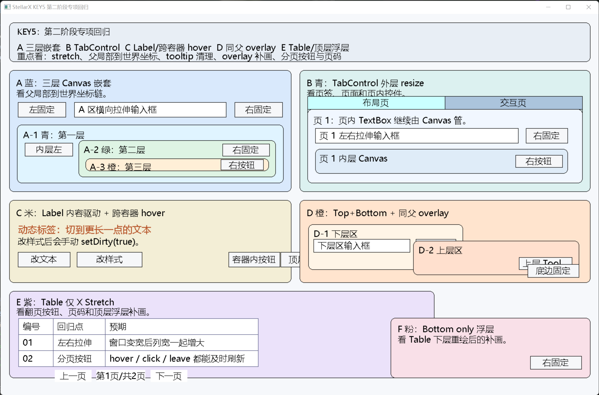
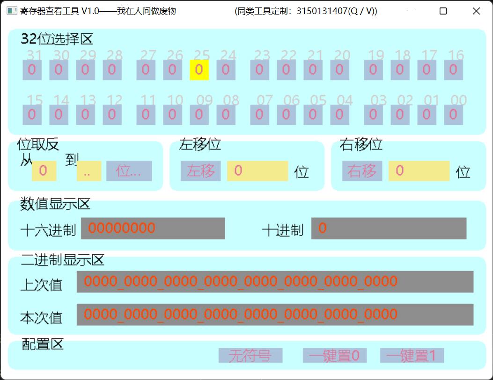
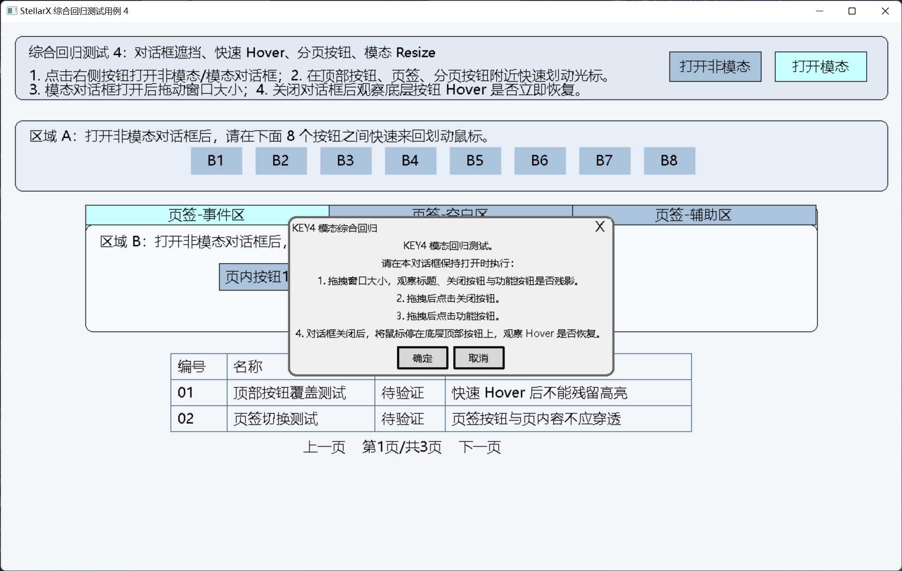

# StellarX GUI Framework

[中文 README](README.md)

Official website: https://stellarx-gui.top
Blog: https://blog.stellarx-gui.top

> Visit the official website for framework information and quick start instructions. For detailed tutorials, see the StellarX page on the personal blog.

> This repository is the main **StellarX** repository. Development and Issue/PR discussions happen on GitHub. GitCode is only a read-only mirror. Please report issues on GitHub: https://github.com/Ysm-04/StellarX

[](https://gitcode.com/Ysm-04/StellarX)


[](https://github.com/Ysm-04/StellarX)


> **“Bounded by the stars, light as dust.”** — A lightweight, modular native C++ GUI framework for Windows.

`StellarX` avoids heavy dependencies, long builds, and steep learning curves. Its goal is to solve common GUI needs for lightweight desktop tools with compact code, clear architecture, and straightforward APIs. It is especially suitable for teaching, utilities, demos, lightweight visualization, and developers who want to understand GUI drawing, event dispatch, layout, and repaint mechanisms.

## UI / Framework Preview

<table>
  <tr>
    <td colspan="2" align="center">
      <strong>KEY5: Layout and Managed Repaint</strong><br>
      
    </td>
  </tr>
  <tr>
    <td align="center">
      <strong>KEY2: New Layout API Migration</strong><br>
      
    </td>
    <td align="center">
      <strong>KEY4: Dialog / MessageBox</strong><br>
      
    </td>
  </tr>
</table>

## Latest Version

### v4.1.0 (2026-10-31)

v4.1.0 builds on the safe ownership and managed repaint work from v4.0.0. It adds a common focus model, normalized keyboard/Pointer/text routing, and a self-rendered single-line TextBox that no longer depends on EasyX `InputBox`.

- **Unified focus model**: `FocusTargetId`, `FocusManager`, focus scopes, Tab/Shift+Tab traversal, activation suspension, and removal fallback now cover Button, TextBox, Table pagination buttons, TabControl tabs, and Dialog.
- **Normalized native input and routing**: Win32 keyboard, text, IME, and Pointer messages enter one strictly ordered event stream before stable control identities receive them. Window activation, modal scope, and IME ownership are explicit gates.
- **Self-rendered TextBox**: a UTF-16 edit model and wide-character GDI layout provide caret, selection, drag selection, horizontal scrolling, editing shortcuts, read-only/password modes, and candidate positioning for Microsoft Pinyin and Sogou Pinyin.
- **Keyboard usability**: Button supports Space activation on key-up and Enter activation on key-down; TabControl supports keyboard entry and arrow navigation; Dialog traversal remains inside the active dialog scope.
- **Drawing and lifetime fixes**: focus repaint lag, non-repainting Dialog interaction, Table/TabControl layer overlap, event-loop shutdown after native-window destruction, and first-use/cross-TextBox IME positioning have been corrected.
- **DPI/IME evidence**: geometry and candidate positioning passed single-monitor checks at 100%, 125%, and 150% scaling. Mixed-DPI multi-monitor behavior is not yet part of the compatibility claim.

Full changelog: [CHANGELOG.en.md](CHANGELOG.en.md)

## Project Structure and Design Philosophy

StellarX uses classic OOP and modular design. `include/src` are separated, `CoreTypes.h` is the central type definition entry, and `StellarX.h` is the main include header.

```text
StellarX/
├── include/
│   └── StellarX/
│       ├── StellarX.h
│       ├── CoreTypes.h
│       ├── FocusManager.h
│       ├── InputEvents.h
│       ├── KeyboardRouting.h
│       ├── TextInputRouting.h
│       ├── TextSelectionRouting.h
│       ├── SxLog.h
│       ├── Control.h
│       ├── Window.h
│       ├── Button.h
│       ├── Label.h
│       ├── TextBox.h
│       ├── Canvas.h
│       ├── TabControl.h
│       ├── Table.h
│       ├── Dialog.h
│       └── MessageBox.h
├── src/
│   ├── internal/
│   │   ├── SxEventLoopInternal.h
│   │   ├── SxImeCaretAnchorInternal.h
│   │   ├── SxNativeInputInternal.h
│   │   ├── SxKeyboardRouterInternal.h
│   │   ├── SxTextInputRouterInternal.h
│   │   ├── SxTextSelectionGestureInternal.h
│   │   └── other private UTF-16 editing/view headers (12 total)
│   ├── Control.cpp
│   ├── FocusManager.cpp
│   ├── KeyboardRouter.cpp
│   ├── TextInputRouter.cpp
│   ├── SxNativeInput.cpp
│   ├── SxImeCaretAnchor.cpp
│   ├── SxInputProbe.cpp
│   ├── SxTextEditModel.cpp
│   ├── SxTextEditController.cpp
│   ├── SxTextSelectionGesture.cpp
│   ├── SxUnicode.cpp
│   ├── SxWideTextView.cpp
│   ├── Window.cpp
│   ├── Button.cpp
│   ├── Label.cpp
│   ├── TextBox.cpp
│   ├── Canvas.cpp
│   ├── TabControl.cpp
│   ├── Table.cpp
│   ├── Dialog.cpp
│   ├── MessageBox.cpp
│   └── SxLog.cpp
├── examples/
├── docs/
├── CMakeLists.txt
├── CHANGELOG.md
├── CHANGELOG.en.md
├── README.md
├── README.en.md
├── 控件 API 文档 (StellarX GUI Framework Controls API Documentation).md
└── LICENSE
```

Design principles:

1. **Single Responsibility**: each control owns its drawing, event, and state boundary.
2. **Dependency Inversion**: containers such as Window, Canvas, and TabControl depend on the `Control` abstraction.
3. **Open/Closed**: derive new controls from `Control`, implement `draw()` and the Pointer-compatible `handleEvent()` entry, then override only the keyboard or text routing capabilities the control needs.
4. **Consistency**: drawing, events, dirty state, visibility, snapshots, and layout APIs follow common conventions.
5. **Lightweight first**: keep the EasyX + C++ low-friction workflow without heavyweight UI dependencies.

## Core Features

- **Light dependencies**: no heavyweight GUI runtime besides EasyX.
- **Native performance**: EasyX / Win32 drawing and message loop for lightweight tools and teaching scenarios.
- **Common controls**: Button, Label, TextBox, Canvas, TabControl, Table, Dialog, and MessageBox.
- **Unified layout semantics**: four-edge anchors, per-axis Stretch/FixedSize, and Start/End/Center/Proportional alignment.
- **Nested containers**: Canvas and TabControl map parent-local child coordinates to window-world coordinates.
- **Stable handles and deferred mutation**: callbacks may request control add/remove/clear operations, which are committed at a safe point.
- **Managed repaint**: event handling mutates state and records dirty coverage; Window commits repaint work in a centralized pass.
- **Logical focus and scopes**: focus stores only stable identities and supports Tab traversal, composite controls, Dialog isolation, reentrant requests, and invalid-target fallback.
- **Keyboard and text routing**: key events may bubble along a frozen identity path, while committed text and transient IME composition are directed to one valid text leaf.
- **Self-rendered text editing**: TextBox uses a UTF-16 model, wide-character layout, selections, clipboard commands, and system IME without opening a separate input dialog.
- **Dialog system**: Dialog supports modal/modeless usage; MessageBox provides a standard factory interface.
- **Debug logging**: SxLog supports console/file output, levels, tag filters, file rotation, and bilingual text selection.

## Quick Start

Get an already published prebuilt package from [Releases](https://github.com/Ysm-04/StellarX/releases/latest), or integrate the current source as described below.

### Requirements

- Windows 10+
- Visual Studio 2019+ or a compatible MSVC toolchain
- C++17
- EasyX 2022+ matching your Visual Studio version
- CMake 3.15+, optional

### Install EasyX

1. Download the latest EasyX.
2. Install the components matching your Visual Studio version.
3. Verify that your sample project can include `easyx.h` and link EasyX.

### Build with CMake

```powershell
git clone https://github.com/Ysm-04/StellarX.git
cd StellarX
cmake -S . -B build -A x64
cmake --build build --config Release
```

### Direct Source Integration

Keep these three parts in their relative layout. Do not move private headers into the public include directory:

| Path | Role | Treatment in your project |
| --- | --- | --- |
| `include/StellarX/*.h` | Public API headers | Put in a public-header group and expose as the application include directory |
| `src/*.cpp` | Framework implementation | Compile every file exactly once |
| `src/internal/*.h` | Implementation-only private headers | Distribute with the source; framework `.cpp` files may include them, application code must not |

When adding the source directly to an existing Visual Studio application project:

1. Place `include/StellarX/*.h`, `src/*.cpp`, and `src/internal/*.h` under a preserved root such as `third_party/StellarX/`.
2. Add these paths under **C/C++ -> General -> Additional Include Directories**:
   - `$(ProjectDir)third_party\StellarX\include\StellarX`
   - `$(ProjectDir)third_party\StellarX\src\internal`
3. The second path exists only so framework implementation files can resolve private headers. Application code must not include files from `src/internal` directly.
4. Add all 22 `.cpp` files directly under `src` to the project. Do not `#include` a `.cpp` file and do not also link another copy of the StellarX static library.
5. Enable C++17 and select **Use Multi-Byte Character Set**. With MSVC, add `/source-charset:utf-8` and `/execution-charset:.936`.
6. Configure the EasyX include/library directories and link EasyX, `user32.lib`, `gdi32.lib`, `shell32.lib`, and `imm32.lib`.
7. Application code should include only `#include "StellarX.h"` and must not depend on the aggregate header's internal include order.

For a solution with multiple executables, create a separate `StellarX.Core` static-library project. Put `src/*.cpp` and all 12 private headers in that library, expose `include/StellarX` as the public include directory, and keep `src/internal` private to the library project. Applications then reference only the static library and the public headers.

When using this repository's CMake target, the private include directory is already encapsulated:

```cmake
add_subdirectory(third_party/StellarX)
target_link_libraries(MyApp PRIVATE StellarX)
```

### First Window

```cpp
#include "StellarX.h"

int WINAPI WinMain(HINSTANCE, HINSTANCE, LPSTR, int)
{
    Window mainWindow(800, 600, EX_SHOWCONSOLE, RGB(255, 255, 255), "My StellarX App");

    auto button = std::make_unique<Button>(30, 30, 160, 42, "Click Me");
    button->setOnClickListener([&mainWindow]()
    {
        StellarX::MessageBox::showModal(
            mainWindow,
            "Button clicked",
            "Notice",
            StellarX::MessageBoxType::OK);
    });

    mainWindow.addControl(std::move(button));
    mainWindow.draw();
    return mainWindow.runEventLoop();
}
```

## CoreTypes Summary

### Common Enums

| Enum | Description | Common values |
| --- | --- | --- |
| `ControlShape` | Control geometry | `RECTANGLE`, `B_RECTANGLE`, `ROUND_RECTANGLE`, `B_ROUND_RECTANGLE`, `CIRCLE`, `B_CIRCLE`, `ELLIPSE`, `B_ELLIPSE` |
| `ButtonMode` | Button behavior | `NORMAL`, `TOGGLE`, `DISABLED` |
| `TextBoxmode` | TextBox mode | `INPUT_MODE`, `READONLY_MODE`, `PASSWORD_MODE` |
| `FillMode` | Fill mode | `Solid`, `Null`, `Hatched`, `Pattern`, `DibPattern` |
| `FillStyle` | Hatch fill style | `Horizontal`, `Vertical`, `FDiagonal`, `BDiagonal`, `Cross`, `DiagCross` |
| `LineStyle` | Border line style | `Solid`, `Dash`, `Dot`, `DashDot`, `DashDotDot`, `Null` |
| `MessageBoxType` | Message box button group | `OK`, `OKCancel`, `YesNo`, `YesNoCancel`, `RetryCancel`, `AbortRetryIgnore` |
| `MessageBoxResult` | Message box result | `OK=1`, `Cancel=2`, `Abort=3`, `Retry=4`, `Ignore=5`, `Yes=6`, `No=7` |
| `TabPlacement` | Tab bar placement | `Top`, `Bottom`, `Left`, `Right` |
| `LayoutMode` | Legacy layout mode | `Fixed`, `AnchorToEdges` |
| `Anchor` | Legacy anchor input | `NoAnchor`, `Left`, `Right`, `Top`, `Bottom` |
| `AxisSizePolicy` | New per-axis size policy | `Stretch`, `FixedSize` |
| `AxisAlignPolicy` | New fixed-size alignment policy | `Start`, `End`, `Center`, `Proportional` |
| `FocusPolicy` | Focus entry capability | `None`, `Click`, `Tab`, `ClickAndTab` |
| `FocusReason` | Focus transition source | `Programmatic`, `Pointer`, `TabTraversal`, `RemovalFallback`, and others |
| `KeyEventType` | Native key phase | `KeyDown`, `KeyUp` |

### Common Structs

| Struct | Description |
| --- | --- |
| `ControlHandle` | Stable control identity for the current process run; safe for lookup/removal but not proof that the object is still alive |
| `ControlText` | Font face, height, width, color, rotation, weight, italic, underline, and strikeout |
| `RouRectangle` | Corner ellipse size for rounded rectangles |
| `AxisLayoutSpec` | Per-axis anchors, size policy, and alignment policy |
| `LayoutSpec` | Horizontal and vertical layout specs |
| `LayoutCapability` | Whether a control allows X/Y axis Stretch |
| `ResolvedLayoutRect` | Parent-local and world rectangles after layout solving |
| `FocusTargetId` | Opaque focus identity made from a control handle and an optional internal node; built-in controls currently use `subNode == 0` |
| `FocusTargetSnapshot` | Capture-time visible, enabled, focusable, tab-stop, scope, and parent state |
| `KeyEvent` / `TextInputEvent` | Keyboard and text events captured on the window owner thread and queued in one strict sequence |
| `ImeCaretAnchorSnapshot` | Client-area caret and text-line geometry published to the system IME |

## Controls Library

### Basic Controls

| Control | Header | Description | Key points |
| --- | --- | --- | --- |
| `Button` | `Button.h` | Versatile button | NORMAL / TOGGLE / DISABLED, shapes, colors, Tooltip, truncation, callbacks |
| `Label` | `Label.h` | Text label | Transparent/opaque background, public `textStyle`, content-driven runtime size |
| `TextBox` | `TextBox.h` | Single-line editor | UTF-16 editing, caret, selection, clipboard, horizontal scrolling, read-only/password modes, and system IME |

### Container Controls

| Control | Header | Description | Key points |
| --- | --- | --- | --- |
| `Window` | `Window.h` | Top-level window | Native input capture, focus management, event routing, resize consolidation, and managed repaint |
| `Canvas` | `Canvas.h` | General container | Parent-local child mapping, nested containers, managed partial repaint root |
| `TabControl` | `TabControl.h` | Tab container | Outer control uses unified layout; tab bar/page internals are self-managed |

### Advanced Controls

| Control | Header | Description | Key points |
| --- | --- | --- | --- |
| `Table` | `Table.h` | Data table | Headers, data, pagination, page label; X-axis stretch and fixed Y-axis size |
| `Dialog` | `Dialog.h` | Dialog container | Modal/modeless, derives from Canvas, recenters instead of stretching |

### Static Factory

| Control | Header | Description | Key points |
| --- | --- | --- | --- |
| `MessageBox` | `MessageBox.h` | Message box factory | `showModal()` blocks and returns result; `showAsync()` uses callback |

## Layout System

v4.1.0 continues to recommend the per-axis layout API instead of extending the old two-anchor model further.

### Core Semantics

- `localx/localy/localWidth/localHeight`: design-time parent-local rectangle and layout baseline.
- `x/y/width/height`: current runtime drawing rectangle.
- Normal resize, container relayout, and unified layout solving do not automatically write back to `local*`.
- Use `commitCurrentGeometryAsDesignRect()` when the current runtime geometry should become the new design baseline.

### Example

```cpp
auto panel = std::make_unique<Canvas>(20, 20, 760, 500);
panel->setHorizontalAnchors(true, true);
panel->setVerticalAnchors(true, true);
panel->setHorizontalSizePolicy(StellarX::AxisSizePolicy::Stretch);
panel->setVerticalSizePolicy(StellarX::AxisSizePolicy::Stretch);

auto rightButton = std::make_unique<Button>(620, 30, 120, 36, "Right");
rightButton->setHorizontalAnchors(false, true);
rightButton->setHorizontalSizePolicy(StellarX::AxisSizePolicy::FixedSize);
rightButton->setHorizontalAlignPolicy(StellarX::AxisAlignPolicy::End);
```

### Common Combinations

| Combination | Behavior |
| --- | --- |
| Left + Right + Stretch | Keep left/right margins and stretch width |
| Left only + FixedSize + Start | Keep left margin and fixed size |
| Right only + FixedSize + End | Keep right margin and fixed size |
| Top + Bottom + Stretch | Keep top/bottom margins and stretch height |
| None + FixedSize + Center | Fixed size, position by center relation |
| None + FixedSize + Proportional | Fixed size, position by design-time position ratio |

### Control Capability Boundaries

- `Canvas`: X/Y stretch by default.
- `TabControl`: outer X/Y stretch; internal tab bar and page area remain self-managed.
- `Table`: X stretch and fixed Y size in the current version.
- `TextBox`: usually X stretch and fixed Y size for visual consistency.
- `Label`: does not default to two-axis Stretch; content changes may drive runtime size.

## Focus, Keyboard, and Text Input

- Every `Window` owns one `FocusManager`. Long-lived state stores `FocusTargetId`; a resolved `Control*` never escapes the current call.
- `Tab` / `Shift+Tab` rebuild the tab-stop list from the current tree each time, so a composite control that materializes after its first draw is not cached as permanently empty.
- Clicking empty Window or Canvas space clears focus. Window deactivation suspends keyboard routing without discarding logical focus, and activation resumes it.
- Keys bubble along the identity path frozen when the event starts. `KeyRouteResult::stopBubble` and `preventFrameworkDefault` are independent decisions.
- Committed text, transient IME composition, and text-selection gestures use separate directed routes and cannot be retargeted by a focus change inside the current callback.
- EasyX `EX_KEY` records are still drained to prevent internal backlog, but they are no longer a business keyboard source for controls.

## TextBox Editing and IME

- Committed text is stored as `std::u16string`. `setTextUtf16()` / `getTextUtf16()` are the lossless Unicode API; the existing `std::string` methods remain a Windows ACP compatibility boundary.
- The maximum length is counted in Unicode scalars. Caret movement, deletion, and selection never split a surrogate pair.
- Arrow keys, Home/End, Backspace, Delete, Shift selection, and `Ctrl+A/C/X/V` are supported.
- Read-only mode may receive focus, select, and copy text but rejects editing. Password mode blocks copying or cutting the real value.
- The framework draws transient IME composition inline and commits the final result exactly once. Focus changes, deactivation, or loss of text eligibility cancel the old composition.
- Candidate placement comes from the TextBox's actual wide-character layout and is primed before the first input. Coordinates are physical HWND client pixels.

## TabControl

- Tab bar supports `Top`, `Bottom`, `Left`, and `Right`.
- Use `addTab(button, page)` to add a tab-button/page-Canvas pair and obtain its stable page index.
- Use `tryAddToPage(index, control)` to append a child. On failure, the function returns ownership to the caller.
- The text overload matches only the first duplicate caption; `indexOf(tabText)` returns `-1` when not found.
- `setActiveIndex(index)` reports success with `bool`. An empty TabControl may record a default index before its first draw.

## Button Text Truncation and Tooltip

- Button truncates overly long single-line text based on pixel width.
- Tooltip supports delay, cursor following, offset, transparent/opaque background, and TOGGLE state text; offset currently takes effect only in cursor-following mode.
- Tooltip display, hide, snapshot cleanup, and managed coverage are stabilized in this version.
- Tooltip intelligent placement is not implemented yet; it will not automatically reposition when outside the client area or covered by upper controls or Dialogs. When cursor following is disabled, Tooltip uses the current mouse X and the button bottom Y for placement.

## Transparent Background and Background Snapshots

- `discardBackground()`: restores old background and releases the snapshot.
- `invalidateBackgroundSnapshot()`: invalidates the snapshot without restoring old pixels.
- Resize paths invalidate snapshots instead of restoring old-size pixels into new regions.
- Tooltip transient layers are excluded from persistent coverage to avoid polluting sibling background snapshots.
- Table still keeps whole-table repaint behavior and the historical Canvas fallback special case for correctness; `Table::draw()` may still call `initTextWaH()` to refresh structural size, which remains a deferred Table-specific debt.

## SxLog

SxLog provides console/file logging, levels, tag filters, file rotation, and bilingual text selection.

```cpp
StellarX::SxLogger::Get().setMinLevel(StellarX::SxLogLevel::Debug);
StellarX::SxLogger::Get().enableFile("stellarx.log", true, 1024 * 1024);

SX_LOGI("Init") << SX_T("窗口创建成功", "Window created");
SX_TRACE_SCOPE("Layout", "resolve layout");
```

If console output causes visible delay during resize or maximize operations, lower the log level, disable console output, or switch to file output. SxLog macros currently use an `if/else` short-circuit form; avoid placing them naked in single-line `if/else` branches without braces.

`SxLogger::setConfig()` returns `bool` in v4.0.0. If a candidate file sink cannot be opened, it returns `false` and preserves the previous configuration and sink.

## Advanced Topics and Best Practices

- Custom controls should derive from `Control`, implement `draw()` and the Pointer-compatible `handleEvent()` entry, and put keyboard behavior in `handleKeyEvent()` rather than waiting for `handleEvent(EX_KEY)`.
- `handleKeyEvent()` controls bubbling and default actions separately. Text-capable controls must use the dedicated text route instead of deriving characters from virtual keys.
- Ensure the EasyX output target is correct before drawing; use `SetWorkingImage(nullptr)` when drawing directly to the screen.
- Prefer marking dirty and requesting managed repaint after state changes; avoid arbitrary direct drawing inside event handlers.
- Store `ControlHandle` values outside containers and use `findControl()` for temporary lookup. Do not retain mutable container references or use a raw pointer after requesting its removal.
- Public setters are user-facing. The unified layout solver uses internal controlled paths to apply runtime rectangles.
- After directly modifying `Label::textStyle`, call `setDirty(true)` if immediate content-size refresh is required.

## Applicability and Limits

Good fits:

- C++/EasyX teaching projects.
- Lightweight desktop utilities.
- GUI mechanism demos.
- Small and medium status panels, configuration panels, and data tables.

Use with caution or avoid for:

- High-performance games or complex animations.
- Mixed-DPI multi-monitor setups or hosts that change DPI awareness dynamically.
- Large commercial front-end projects with complex accessibility requirements.
- Cross-platform GUI applications.

## Current Known Limitations

- Table internal partial repaint is not complete yet.
- Table does not support vertical Stretch yet.
- Table structural size refresh may still happen in the draw path.
- The historical Canvas fallback special case for Table remains.
- Tooltip intelligent placement is not implemented yet.
- Global automatic font scaling is not implemented yet.
- TextBox is a single-line editor; multiline layout, undo/redo, and rich text are not provided.
- Dialog manages its built-in content and buttons but does not yet expose a public arbitrary-child-control API.
- Single-monitor 100%/125%/150% DPI has been exercised; mixed-DPI multi-monitor behavior has not received manual acceptance testing.

## Upgrade and Compatibility

From v4.0.0 to v4.1.0:

- `Control` adds focus, keyboard, text, composition, and selection-routing virtuals, while `Window` and several controls change layout. Rebuild binary derived controls and all static libraries.
- `handleEvent(EX_KEY)` no longer receives business keyboard messages. Custom controls should override `handleKeyEvent()` and implement the dedicated text capability when they accept text.
- TextBox no longer opens EasyX `InputBox`. Use `setTextUtf16()` / `getTextUtf16()` for lossless Unicode; `setText(std::string)` / `getText()` remain Windows ACP compatibility APIs.
- Button, TextBox, Table pagination buttons, TabControl tabs, and Dialog now share one focus tree. Leave the default `FocusPolicy::None` when a custom control must not participate.
- Treat the source release as one unit: public headers, all 22 `.cpp` files, and all 12 private headers must come from the same version. Do not copy only newly added files.

From v3.1.0 to v4.0.0:

- `Window::getControls()` and `Canvas::getControls()` were removed. Use `addControl()`, `removeControl()`, `clearControls()`, `findControl()`, and `getControlHandles()`.
- Replace `Canvas::clearAllControls()` with `clearControls()`.
- Replace `ControlText::lpszFace` with the owning `faceName` string.
- Replace `TabControl::add(...)` with `addTab()` / `tryAddToPage()`. `setActiveIndex()` now returns `bool`.
- `SxLogger::setConfig()` now returns `bool`; callers should handle file-sink configuration failure.
- After requesting control removal from a callback, do not access that control again. Destruction is deferred until the outermost structural-mutation transaction ends.

## License

MIT. See [LICENSE](LICENSE).

## Contributing Guidelines

- Follow the existing C++ style.
- New features should include examples, documentation, and regression notes.
- Self-test before submitting and explain the motivation for changes.
- Submit bugs or ideas as GitHub Issues.

## Acknowledgements

- Thanks to [EasyX](https://easyx.cn/).
- Thanks to developers who value simple, efficient, and clear GUI design.

**Stars and seas, code as the vessel.**

## Support and Feedback

- See [examples/](examples/).
- Read [CHANGELOG.en.md](CHANGELOG.en.md).
- Submit an Issue on GitHub: https://github.com/Ysm-04/StellarX/issues
