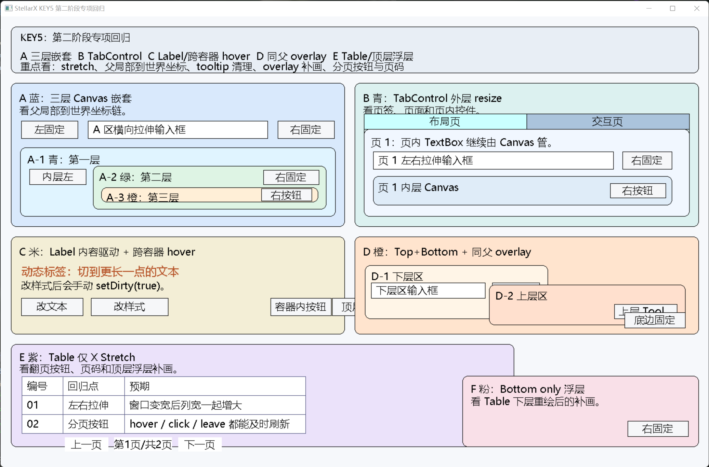
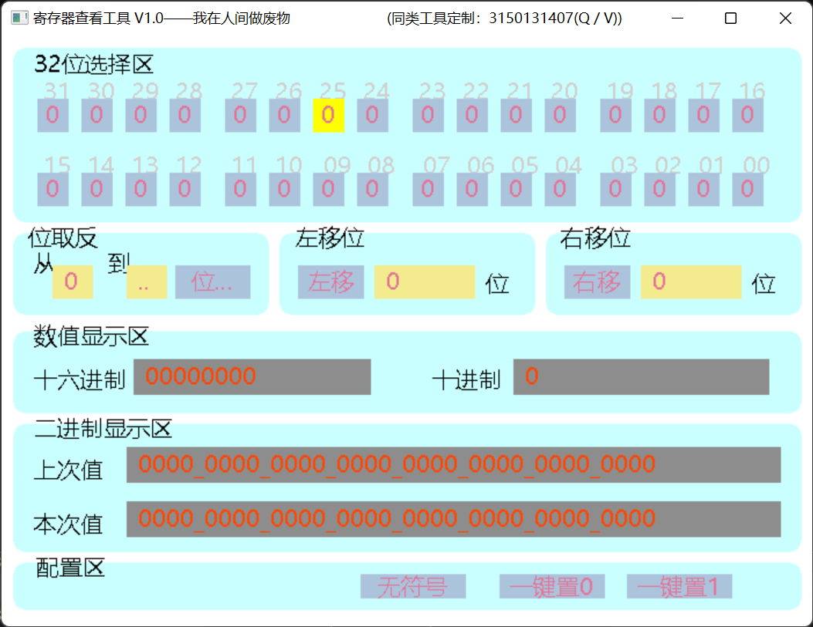
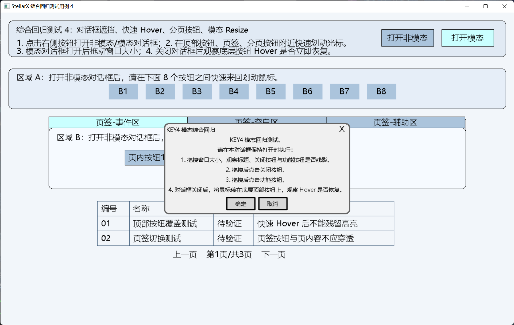

# 星垣 (StellarX) GUI Framework

[English document](README.en.md)

官网地址：https://stellarx-gui.top
博客：https://blog.stellarx-gui.top

> 框架信息以及快速开始可前往官网查看，详细教程可前往个人博客的 StellarX 星垣页面查看。

> 本仓库为 **StellarX** 主仓，开发与 Issue/PR 均在 GitHub 进行。GitCode 仅为只读镜像，如需反馈请到 GitHub：https://github.com/Ysm-04/StellarX

[](https://gitcode.com/Ysm-04/StellarX)


[](https://github.com/Ysm-04/StellarX)


> **「繁星为界，轻若尘埃」** —— 一个为 Windows 平台打造的轻量级、模块化 C++ 原生 GUI 框架。

`星垣 (StellarX)` 反对臃肿依赖、漫长编译和高门槛学习曲线，目标是用精简代码、清晰架构和直观 API 解决轻量桌面工具开发中的常见 GUI 需求。它更适合教学、工具、演示和轻量可视化场景，也适合希望理解 GUI 绘制、事件分发、布局和重绘机制的开发者。

## 界面 / 框架预览

<table>
  <tr>
    <td colspan="2" align="center">
      <strong>
KEY5：布局与托管重绘专项
</strong><br>
      
    </td>
  </tr>
  <tr>
    <td align="center">
      <strong>
KEY2：新布局 API 迁移样例
</strong><br>
      
    </td>
    <td align="center">
      <strong>
KEY4：Dialog / MessageBox 专项
</strong><br>
      
    </td>
  </tr>
</table>

## 最新版本

### v3.1.0 (2026-05-15)

v3.1.0 是一次布局与托管重绘稳定化版本，重点把前一阶段已经落地的能力整理为可说明、可验证、可迁移的公开语义。

- **新布局 API 正式收口**：新增四边锚点集合、单轴尺寸策略 `AxisSizePolicy`、单轴固定尺寸位移策略 `AxisAlignPolicy`，并保留旧 `setLayoutMode()` / `setAnchor()` 作为兼容输入层。
- **几何语义明确**：`localx/localy/localWidth/localHeight` 是设计态父局部矩形，`x/y/width/height` 是当前运行态绘制矩形；普通 resize 和布局解算不会自动回写设计基线。
- **托管重绘链路稳定化**：进一步收口 Window / Canvas / TabControl / Table / Dialog 的脏区、coverage、overlay 和 Tooltip 临时浮层处理，降低遮挡、残影、错层和 hover 残留风险。
- **Dialog / MessageBox 稳定性延续**：Dialog 在宿主窗口 resize 时继续保持居中，不参与拉伸；MessageBox 保持薄工厂层语义。
- **当前边界明确**：Table 当前版本为 X 轴可拉伸、Y 轴固定；Tooltip 暂未实现智能选位；焦点与键盘事件系统仍为后续专题。

完整更新日志：[CHANGELOG.md](CHANGELOG.md)

## 项目结构与设计哲学

StellarX 采用经典 OOP 与模块化设计，`include/src` 分离，`CoreTypes.h` 作为基础类型定义入口，`StellarX.h` 作为主包含头文件。

```text
StellarX/
├── include/
│   └── StellarX/
│       ├── StellarX.h
│       ├── CoreTypes.h
│       ├── SxLog.h
│       ├── Control.h
│       ├── Window.h
│       ├── Button.h
│       ├── Label.h
│       ├── TextBox.h
│       ├── Canvas.h
│       ├── TabControl.h
│       ├── Table.h
│       ├── Dialog.h
│       └── MessageBox.h
├── src/
│   ├── Control.cpp
│   ├── Window.cpp
│   ├── Button.cpp
│   ├── Label.cpp
│   ├── TextBox.cpp
│   ├── Canvas.cpp
│   ├── TabControl.cpp
│   ├── Table.cpp
│   ├── Dialog.cpp
│   ├── MessageBox.cpp
│   └── SxLog.cpp
├── examples/
├── docs/
├── CMakeLists.txt
├── CHANGELOG.md
├── CHANGELOG.en.md
├── README.md
├── README.en.md
├── 控件 API 文档 (StellarX GUI Framework Controls API Documentation).md
└── LICENSE
```

设计原则：

1. **单一职责**：每个控件类负责自身绘制、事件和状态边界。
2. **依赖倒置**：Window、Canvas、TabControl 等容器依赖 `Control` 抽象，而不是硬编码所有控件类型。
3. **开闭原则**：新增控件优先继承 `Control`，实现 `draw()` 与 `handleEvent()`。
4. **一致性**：绘制、事件、dirty、可见性、背景快照和布局接口尽量保持统一。
5. **轻量优先**：不引入重量级 UI 依赖，保留 EasyX + C++ 的低门槛特性。

## 核心特性

- **轻量依赖**：除 EasyX 外无大型 GUI 运行时依赖。
- **原生性能**：基于 EasyX / Win32 绘制与消息循环，适合轻量工具和教学场景。
- **控件齐全**：Button、Label、TextBox、Canvas、TabControl、Table、Dialog、MessageBox。
- **统一布局语义**：支持四边锚点、单轴 Stretch/FixedSize、Start/End/Center/Proportional 位移策略。
- **容器嵌套**：Canvas 与 TabControl 支持父局部坐标到窗口世界坐标的映射。
- **托管重绘**：事件阶段只修改状态并登记脏区，Window 在收口阶段统一提交重绘。
- **对话框体系**：Dialog 支持模态/非模态，MessageBox 提供标准消息框工厂接口。
- **调试日志**：SxLog 支持控制台/文件输出、级别过滤、Tag 过滤和中英文日志文本选择。

## 快速开始

从 [Releases](https://github.com/Ysm-04/StellarX/releases/latest) 获取预编译包，或直接集成源码。

### 环境要求

- Windows 10+
- Visual Studio 2019+ 或兼容 MSVC 工具链
- C++17
- EasyX 2022+，并与当前 Visual Studio 版本匹配
- CMake 3.12+，可选

### 安装 EasyX

1. 下载 EasyX 最新版。
2. 按 Visual Studio 版本安装匹配组件。
3. 确认示例工程可以正常包含 `easyx.h` 并链接 EasyX。

### CMake 构建

```bash
git clone https://github.com/Ysm-04/StellarX.git
cd StellarX
mkdir build
cd build
cmake ..
cmake --build .
```

### 手动集成

- 拷贝 `include` 与 `src` 到工程中。
- 配置头文件搜索路径：`include/StellarX/`。
- 将 `src` 下全部 `.cpp` 加入工程编译。
- 在业务代码中包含：`#include "StellarX.h"`。

### 第一个窗口

```cpp
#include "StellarX.h"

int WINAPI WinMain(HINSTANCE, HINSTANCE, LPSTR, int)
{
    Window mainWindow(800, 600, NULL, RGB(255, 255, 255), "我的星垣应用");

    auto button = std::make_unique<Button>(30, 30, 160, 42, "Click Me");
    button->setOnClickListener([]()
    {
        SX_LOGI("Demo") << SX_T("按钮被点击", "Button clicked");
    });

    mainWindow.addControl(std::move(button));
    mainWindow.draw();
    return mainWindow.runEventLoop();
}
```

## CoreTypes 摘要

### 常用枚举

| 枚举 | 描述 | 常用值 |
| --- | --- | --- |
| `ControlShape` | 控件几何形状 | `RECTANGLE`, `B_RECTANGLE`, `ROUND_RECTANGLE`, `B_ROUND_RECTANGLE`, `CIRCLE`, `B_CIRCLE`, `ELLIPSE`, `B_ELLIPSE` |
| `ButtonMode` | 按钮行为 | `NORMAL`, `TOGGLE`, `DISABLED` |
| `TextBoxmode` | 文本框模式 | `INPUT_MODE`, `READONLY_MODE`, `PASSWORD_MODE` |
| `FillMode` | 填充模式 | `Solid`, `Null`, `Hatched`, `Pattern`, `DibPattern` |
| `FillStyle` | 图案填充样式 | `Horizontal`, `Vertical`, `FDiagonal`, `BDiagonal`, `Cross`, `DiagCross` |
| `LineStyle` | 边框线型 | `Solid`, `Dash`, `Dot`, `DashDot`, `DashDotDot`, `Null` |
| `MessageBoxType` | 消息框按钮组合 | `OK`, `OKCancel`, `YesNo`, `YesNoCancel`, `RetryCancel`, `AbortRetryIgnore` |
| `MessageBoxResult` | 消息框结果 | `OK=1`, `Cancel=2`, `Abort=3`, `Retry=4`, `Ignore=5`, `Yes=6`, `No=7` |
| `TabPlacement` | 页签栏位置 | `Top`, `Bottom`, `Left`, `Right` |
| `LayoutMode` | 旧布局模式 | `Fixed`, `AnchorToEdges` |
| `Anchor` | 旧锚点输入 | `NoAnchor`, `Left`, `Right`, `Top`, `Bottom` |
| `AxisSizePolicy` | 新单轴尺寸策略 | `Stretch`, `FixedSize` |
| `AxisAlignPolicy` | 新单轴固定尺寸位移策略 | `Start`, `End`, `Center`, `Proportional` |

### 常用结构体

| 结构体 | 描述 |
| --- | --- |
| `ControlText` | 字体名称、高度、宽度、颜色、旋转、字重、斜体、下划线、删除线等文本样式 |
| `RouRectangle` | 圆角矩形角部椭圆尺寸 |
| `AxisLayoutSpec` | 单轴锚点集合、尺寸策略和位移策略 |
| `LayoutSpec` | 水平轴与垂直轴布局规格组合 |
| `LayoutCapability` | 控件是否允许 X/Y 轴 Stretch 的能力边界 |
| `ResolvedLayoutRect` | 布局解算后的父局部矩形与世界坐标矩形 |

## 控件库

### 基础控件

| 控件 | 头文件 | 描述 | 重点 |
| --- | --- | --- | --- |
| `Button` | `Button.h` | 多功能按钮 | NORMAL / TOGGLE / DISABLED，形状、颜色、Tooltip、文本截断、点击回调 |
| `Label` | `Label.h` | 文本标签 | 透明/不透明背景，公开 `textStyle`，内容驱动运行态尺寸 |
| `TextBox` | `TextBox.h` | 文本框 | 输入、只读、密码模式，基于 EasyX InputBox 的轻量输入 |

### 容器控件

| 控件 | 头文件 | 描述 | 重点 |
| --- | --- | --- | --- |
| `Window` | `Window.h` | 顶层窗口 | 背景、事件循环、resize 收口、托管重绘入口 |
| `Canvas` | `Canvas.h` | 通用容器 | 子控件父局部坐标映射、嵌套容器、托管局部提交 root |
| `TabControl` | `TabControl.h` | 页签容器 | 外层参与统一布局，内部页签栏和页面区自管 |

### 高级控件

| 控件 | 头文件 | 描述 | 重点 |
| --- | --- | --- | --- |
| `Table` | `Table.h` | 数据表格 | 表头、数据、分页、页码；当前 X 轴可拉伸、Y 轴固定 |
| `Dialog` | `Dialog.h` | 对话框容器 | 模态/非模态，继承 Canvas，resize 时只重新居中 |

### 静态工厂

| 控件 | 头文件 | 描述 | 重点 |
| --- | --- | --- | --- |
| `MessageBox` | `MessageBox.h` | 消息框工厂 | `showModal()` 阻塞返回结果，`showAsync()` 非模态回调 |

## 布局系统

v3.1.0 推荐使用新的单轴布局 API，而不是继续扩展旧双锚点模型。

### 核心语义

- `localx/localy/localWidth/localHeight`：设计态父局部矩形，是布局解算基线。
- `x/y/width/height`：当前运行态绘制矩形。
- 普通 resize、容器重排和统一布局解算不会自动回写 `local*`。
- 如需把当前运行态同步为新的设计基线，请调用 `commitCurrentGeometryAsDesignRect()`。

### 规则示例

```cpp
auto panel = std::make_unique<Canvas>(20, 20, 760, 500);
panel->setHorizontalAnchors(true, true);
panel->setVerticalAnchors(true, true);
panel->setHorizontalSizePolicy(StellarX::AxisSizePolicy::Stretch);
panel->setVerticalSizePolicy(StellarX::AxisSizePolicy::Stretch);

auto rightButton = std::make_unique<Button>(620, 30, 120, 36, "Right");
rightButton->setHorizontalAnchors(false, true);
rightButton->setHorizontalSizePolicy(StellarX::AxisSizePolicy::FixedSize);
rightButton->setHorizontalAlignPolicy(StellarX::AxisAlignPolicy::End);
```

### 常用组合

| 组合 | 行为 |
| --- | --- |
| Left + Right + Stretch | 保持左右边距，宽度随父容器变化 |
| Left only + FixedSize + Start | 保持左边距，尺寸固定 |
| Right only + FixedSize + End | 保持右边距，尺寸固定 |
| Top + Bottom + Stretch | 保持上下边距，高度随父容器变化 |
| None + FixedSize + Center | 尺寸固定，按中心关系定位 |
| None + FixedSize + Proportional | 尺寸固定，按设计态位置比例定位 |

### 控件能力边界

- `Canvas`：默认 X/Y 可拉伸。
- `TabControl`：外层 X/Y 可拉伸，内部页签栏和页面区自管。
- `Table`：当前版本 X 可拉伸、Y 固定。
- `TextBox`：通常 X 可拉伸、Y 固定更符合输入框视觉。
- `Label`：默认不做双轴 Stretch，内容变化可驱动自身运行态尺寸。

## TabControl

- 页签栏支持 `Top`、`Bottom`、`Left`、`Right`。
- 可通过 `add(std::string tabText, std::unique_ptr<Control> control)` 向指定页签添加子控件。
- `indexOf(tabText)` 找到匹配页签返回索引，未找到返回 `-1`。
- 本版本只收口外层布局和重绘职责，不重写内部页签栏/页面区机制。

## Button 文本截断与 Tooltip

- Button 会根据像素宽度对过长文本进行单行截断。
- Tooltip 支持延时、跟随鼠标、偏移量、透明/不透明背景和 TOGGLE 状态文案；当前偏移量仅在跟随鼠标模式下生效。
- 当前版本已收口 Tooltip 显示、隐藏、快照清理和托管 coverage。
- 当前版本暂未实现 Tooltip 智能选位；超出客户区或被上层控件、Dialog 遮挡时不会自动换方向。不跟随鼠标时，Tooltip 使用当前鼠标 X 与按钮底部 Y 进行定位。

## 透明背景与背景快照

- `discardBackground()`：回贴旧背景并释放快照。
- `invalidateBackgroundSnapshot()`：仅作废快照，不回贴旧背景。
- resize 路径默认只作废快照，避免把旧尺寸背景回贴到新区域。
- Tooltip 等临时浮层不会进入持久 coverage，避免污染兄弟控件背景快照。
- Table 当前仍保留整表重绘和 Canvas 历史兜底特判，以保证正确性；`Table::draw()` 仍可能触发 `initTextWaH()` 刷新结构尺寸，这是后续 Table 专项技术债。

## 日志系统 SxLog

SxLog 提供控制台/文件日志、日志级别、Tag 过滤、文件滚动和中英文文本选择。

```cpp
StellarX::SxLogger::Get().setMinLevel(StellarX::SxLogLevel::Debug);
StellarX::SxLogger::Get().enableFile("stellarx.log", true, 1024 * 1024);

SX_LOGI("Init") << SX_T("窗口创建成功", "Window created");
SX_TRACE_SCOPE("Layout", "resolve layout");
```

如果控制台输出影响 resize 或最大化期间的观感，可降低日志级别、关闭控制台输出，或改用文件输出。SxLog 宏当前为 `if/else` 短路形式，不建议裸放在未加大括号的 `if/else` 单行分支中。

## 高级主题与最佳实践

- 自定义控件应继承 `Control`，实现 `draw()` 与 `handleEvent()`。
- 事件已处理时返回 `true`，避免继续向下层控件分发。
- 绘制前确保 EasyX 输出目标正确；需要直接画屏幕时应保证 `SetWorkingImage(nullptr)`。
- 状态变化后优先标脏并请求托管重绘，不要在事件处理中随意直接绘制。
- 公开 setter 面向用户使用；统一布局器使用内部受控路径应用运行态矩形。
- 直接修改 `Label::textStyle` 后，如需立即刷新内容尺寸，请调用 `setDirty(true)`。

## 适用与限制

适用场景：

- C++/EasyX 教学项目。
- 轻量桌面工具。
- GUI 原理演示。
- 数据表格、状态面板、配置面板等中小型界面。

不适用或需谨慎的场景：

- 高性能游戏或复杂动画。
- 高 DPI、多显示器复杂缩放适配场景。
- 大型商业前端或复杂无障碍要求项目。
- 跨平台 GUI。

## 当前已知限制

- 尚未实现焦点系统。
- 尚未实现键盘事件系统。
- TextBox 仍基于 EasyX InputBox，未重写自绘输入体系。
- Table 内部局部重绘体系尚未完成。
- Table 暂不支持纵向 Stretch。
- Table 结构尺寸刷新仍可能发生在 draw 流程中。
- Canvas 对 Table 的历史兜底特判仍保留。
- TabControl 内部布局应用路径尚未完全收口。
- Tooltip 尚未实现完整智能选位。
- 暂无全局字体自动缩放系统。

## 许可证

MIT，见 [LICENSE](LICENSE)。

## 贡献指南

- 遵循现有 C++ 代码风格。
- 新特性应补充示例、文档和回归说明。
- 提交前请自测，并说明变更动机。
- Bug 或想法请提交 Issue。

## 致谢

- 感谢 [EasyX](https://easyx.cn/)。
- 感谢所有关注简洁、高效、清晰 GUI 设计的开发者。

**星辰大海，代码为舟。**

## 支持与反馈

- 查看 [examples/](examples/)。
- 阅读 [CHANGELOG.md](CHANGELOG.md)。
- 在 GitHub 提交 Issue：https://github.com/Ysm-04/StellarX/issues
